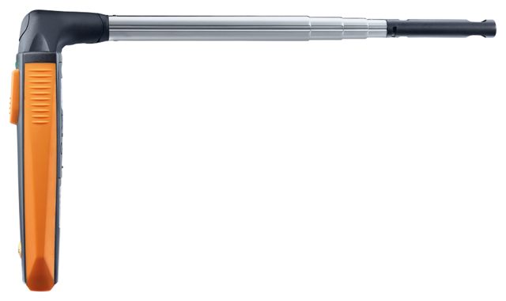

# Testo 405i for Home Assistant

[](https://github.com/jaxer/ha-testo-405i/actions/workflows/ci.yml)
[](https://hacs.xyz)

<a href="https://www.testo.com/en/testo-405i/p/0560-1405"></a>

Local Bluetooth integration for the **Testo 405i** thermal anemometer smart probe. Home Assistant
connects to the probe through any Bluetooth adapter or ESPHome Bluetooth proxy and reads the
measurement stream directly: no Testo Smart app, no cloud.

This is an independent project, not affiliated with Testo.

<br clear="right">

## What you get

| Entity | Meaning |
|---|---|
| Velocity | Air velocity at the hot wire, m/s. Exactly 0.00 is a real reading in still air. |
| Temperature | Air temperature at the probe tip, °C. |
| Flow | Velocity × cross-section of the round duct set in *Duct diameter*, l/s. |
| Duct diameter | The round duct the flow is computed for, 50–500 mm (default 100). Survives restarts. |
| Battery | Battery level, %. Keeps its last value after the probe switches off. |

Velocity, temperature and flow update about once a second and are unavailable while the probe is
switched off.

## Requirements

* Home Assistant 2026.10 or newer with the [Bluetooth](https://www.home-assistant.io/integrations/bluetooth/)
  integration: a local adapter or an [ESPHome Bluetooth proxy](https://esphome.io/components/bluetooth_proxy)
  with `active: true` within range of the probe.
* The probe accepts one connection at a time: close the Testo Smart app before switching it on.

## Installation

### HACS

1. HACS → ⋮ → *Custom repositories*, add `https://github.com/jaxer/ha-testo-405i` as an
   *Integration*.
2. Install **Testo 405i** and restart Home Assistant.

### Manual

Copy `custom_components/testo_405i` into your `config/custom_components` folder and restart.

## Setup

Switch the probe on. Home Assistant discovers it and offers to add it under
Settings → Devices & services. You can also add **Testo 405i** by hand from the same page while the
probe is on.

From then on Home Assistant connects whenever the probe is switched on and lets go when it
switches off.

## Measuring a duct

Take the diffuser off and hold the probe in the open duct with the sensor window across the flow.
Velocity is higher in the centre than at the wall, so move the probe slowly across the diameter
and average the readings. Set *Duct diameter* to the duct's inner diameter: in a Ø100 duct 1 m/s is
7.85 l/s.

## Troubleshooting

* **Velocity updates but temperature stays unknown.** The Bluetooth proxy is losing the
  temperature message, the only one longer than 20 bytes. Seen on a proxy running ESPHome 2026.6;
  updating it to 2026.11 fixed it. Details in [docs/protocol.md](docs/protocol.md).
* **The probe is on but stays unavailable.** Check that the Testo Smart app is closed and that the
  proxy has `active: true`. The connection becomes unreliable at about −82 dBm and weaker: bring a
  proxy closer.
* **Debug log.** Every raw notification and the negotiated MTU are logged at debug level:

  ```yaml
  logger:
    logs:
      custom_components.testo_405i: debug
  ```

## Protocol

Testo does not publish the probe's Bluetooth protocol; what this integration relies on was found
by experiment and is written down in [docs/protocol.md](docs/protocol.md). The parser lives in
[`protocol.py`](custom_components/testo_405i/protocol.py), pure Python with tests against
notifications captured from a real probe.

## Development

```bash
python3.14 -m venv .venv && . .venv/bin/activate
pip install -r requirements_test.txt
ruff check . && ruff format --check . && pytest
```

## License

MIT
